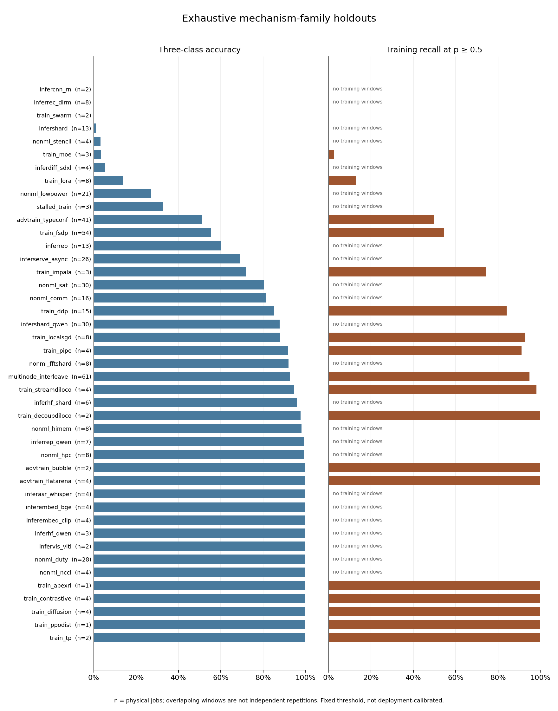

# Corrected multi-node classifier evaluations

These results use the frozen October 12 input snapshot, with corrected physical-job identities, window labels, recovered NIC/log inputs, and exhaustive family holdouts. The two subsequently recovered Spot-preempted A100 captures remain in the corpus but are **not** part of this evaluation snapshot.

Read the [review and priorities](REVIEW.md), [reproduction instructions](REPRODUCING.md), [storage and recovery notes](DURABILITY.md), and [sensitivity interpretation](SENSITIVITY_REVIEW.md).

## Accuracy and detection

| Evaluation | Families | Jobs | Windows | Accuracy | Macro F1 | Training recall | Non-training window FPR | Benign job FPR | Alert episodes/benign job-hour |
| --- | --- | --- | --- | --- | --- | --- | --- | --- | --- |
| Mechanism holdout | 43 | 479 | 19298 | 71.14% | 0.704 | 69.23% | 11.23% | 17.95% | 3.790 |
| Backbone holdout | 31 | 479 | 19298 | 68.97% | 0.686 | 63.14% | 10.91% | 17.95% | 3.790 |
| STEP-only mechanism holdout | 26 | 315 | 12954 | 73.13% | 0.605 | 78.88% | 12.25% | 24.14% | 3.579 |

Accuracy and macro F1 use three-class argmax predictions. Detection and false-positive rates use training probability ≥ 0.5. This threshold was fixed before testing; it was not calibrated to an operational false-alert budget. A job is alerted if any observed window crosses the threshold.

The window FPR includes non-training windows within mixed jobs. The benign-job FPR includes only jobs with no training-labelled windows. Any-window training-job recall can count an alert in a non-training phase; the stricter supplementary count below requires an alert in an observed training window.

Each model is a 300-tree random forest (seed 0, max_features=0.3, min_samples_leaf=2), with medians fitted only on its training fold. Windows span 30 seconds with a 15-second stride. The full feature vocabulary has 675 telemetry features. The backbone grouping specifically merges programs sharing the custom RandomTransformerLM implementation; it is not a comprehensive independent-implementation or architecture holdout. The backbone and STEP-only rows are separate evaluations; their score differences are not paired estimates of a label-quality or feature effect.

## Paired October campaign ablation

The baseline removes jobs from campaigns `20261001` and `20261003` only from training. Both arms score exactly the same old-job test windows while holding out the same complete family. New-job test results are reported separately.

| Test population / arm | Jobs | Windows | Accuracy | Macro F1 | Training recall | Window FPR |
| --- | --- | --- | --- | --- | --- | --- |
| Old jobs / baseline | 453 | 18131 | 75.44% | 0.746 | 70.98% | 6.90% |
| Old jobs / full | 453 | 18131 | 70.88% | 0.704 | 68.10% | 11.04% |
| New jobs / full | 26 | 1167 | 75.15% | 0.399 | 76.55% | 35.23% |

Family-macro paired accuracy change: **-0.57 percentage points**; 95% family-bootstrap interval [-5.11, +3.62] points over 34 paired families (2,000 resamples, seed 0). This interval describes family resampling of these saved predictions, not independent campaigns, forest seeds, or future deployments.

## Held-out attack performance

| Workload kind | Jobs | Windows | Accuracy | Training recall | Training-job recall | Window FPR |
| --- | --- | --- | --- | --- | --- | --- |
| adversarial | 91 | 3733 | 76.08% | 74.75% | 98.90% | 7.89% |
| control | 20 | 829 | 79.98% | — | — | 0.00% |
| honest | 368 | 14736 | 69.39% | 65.09% | 81.74% | 12.24% |

The adversarial row measures the existing attack-labelled workloads under mechanism-family holdout. The eligible attack data covers 4 mechanism groups: `advtrain_bubble`, `advtrain_flatarena`, `advtrain_typeconf`, `multinode_interleave`. It does not evaluate a new adaptive attacker against a frozen deployed detector, certify robustness, or establish that the attacks preserved useful learning.

| Training-job population | Training jobs | Detected during a training window | Recall during training |
| --- | --- | --- | --- |
| all | 206 | 184 | 89.32% |
| adversarial | 91 | 90 | 98.90% |

| Logged training share | Jobs represented | Windows | Training recall | Window FPR |
| --- | --- | --- | --- | --- |
| 0% | 250 | 6383 | — | 6.72% |
| 0-5% | 24 | 26 | 61.54% | — |
| 5-20% | 45 | 170 | 89.41% | — |
| 20-50% | 98 | 527 | 96.39% | — |
| 50-100% | 163 | 5848 | 68.28% | — |

Training share is the logged fraction of window time attributed to training, not preserved throughput, energy efficiency, or learning utility. A job can appear in several share bins. These bins include all STEP-labelled workloads, rather than only attacks.

## Generalization and label provenance

| Hardware | Jobs | Windows | Accuracy | Training recall | Window FPR |
| --- | --- | --- | --- | --- | --- |
| Google TPU v5e | 92 | 3799 | 69.89% | 56.16% | 5.21% |
| Google TPU v6e | 108 | 4444 | 80.47% | 85.64% | 6.06% |
| NVIDIA A100-SXM4-40GB | 139 | 5475 | 66.63% | 70.44% | 18.25% |
| NVIDIA A100-SXM4-80GB | 49 | 1964 | 67.21% | 38.21% | 8.46% |
| NVIDIA H100 80GB HBM3 | 91 | 3616 | 69.97% | 70.02% | 14.90% |

These hardware strata come from mechanism holdouts; they are not leave-one-hardware-out tests.

| Label source | Jobs represented | Windows | Accuracy | Training recall | Window FPR |
| --- | --- | --- | --- | --- | --- |
| program | 164 | 6344 | 67.81% | 61.19% | 17.17% |
| steps | 315 | 12954 | 72.77% | 71.05% | 6.72% |

705 eligible multi-node windows from 15 jobs lack resolved work labels and were excluded before fitting or scoring. Program-derived labels are weaker than recorded STEP evidence and do not establish activity onset.

## Operational exposure and delay

| Evaluation | Benign jobs | Observed benign job-hours | False-alert jobs | Alert episodes | Onset-eligible jobs | Missed jobs | Censored STEP onsets | Detected median delay bounds (s) |
| --- | --- | --- | --- | --- | --- | --- | --- | --- |
| mechanism_paired | 273 | 46.175 | 49 | 175 | 100 | 3 | 70 | 0.000–30.000 |
| backbone | 273 | 46.175 | 49 | 175 | 100 | 11 | 70 | 0.000–30.000 |
| steps_only | 145 | 25.425 | 35 | 91 | 100 | 2 | 70 | 0.000–30.000 |

Exposure is the union of observed windows in entirely non-training-labelled jobs. Overlap and unobserved gaps add no exposure. Mixed jobs are excluded from the benign-hour denominator. An alert episode starts after a negative window or a gap greater than 1.5 strides. Delay bounds require adjacent STEP-backed non-training and training windows; program-only onsets and left/gap-censored onsets cannot establish delay. Delay quantiles include detected eligible jobs only; misses are reported separately. Decisions occur at window end and omit computation/transport latency.

## Per-family results



[Vector figure](mechanism_families.svg)

[All evaluation families as CSV](family_results.csv)

Mechanism holdouts, ordered by three-class accuracy. Small families can have extreme scores with little independent evidence. Families with only one eligible job: `train_apexrl`, `train_ppodist`. See `family_results.csv` for all three evaluations.

| Family | Jobs | Windows | Accuracy | Training recall | Window FPR |
| --- | --- | --- | --- | --- | --- |
| infercnn_rn | 2 | 78 | 0.00% | — | 0.00% |
| inferrec_dlrm | 8 | 315 | 0.00% | — | 49.84% |
| train_swarm | 2 | 78 | 0.00% | 0.00% | — |
| infershard | 13 | 509 | 0.98% | — | 0.20% |
| nonml_stencil | 4 | 158 | 3.16% | — | 0.00% |
| train_moe | 3 | 119 | 3.36% | 2.52% | — |
| inferdiff_sdxl | 4 | 167 | 5.39% | — | 93.41% |
| train_lora | 8 | 334 | 13.77% | 12.87% | — |
| nonml_lowpower | 21 | 825 | 27.15% | — | 36.85% |
| stalled_train | 3 | 119 | 32.77% | — | 0.00% |
| advtrain_typeconf | 41 | 1623 | 51.14% | 49.74% | 17.54% |
| train_fsdp | 54 | 2151 | 55.28% | 54.58% | 5.66% |
| inferrep | 13 | 512 | 60.16% | — | 0.00% |
| inferserve_async | 26 | 1011 | 69.24% | — | 29.67% |
| train_impala | 3 | 125 | 72.00% | 74.36% | 0.00% |
| nonml_sat | 30 | 1237 | 80.52% | — | 19.48% |
| nonml_comm | 16 | 647 | 81.30% | — | 0.00% |
| train_ddp | 15 | 607 | 85.17% | 84.03% | 0.00% |
| infershard_qwen | 30 | 1110 | 87.84% | — | 4.14% |
| train_localsgd | 8 | 430 | 88.14% | 92.92% | 47.62% |
| train_pipe | 4 | 180 | 91.67% | 91.11% | — |
| nonml_fftshard | 8 | 313 | 92.01% | — | 0.00% |
| multinode_interleave | 61 | 2579 | 92.79% | 94.84% | 1.29% |
| train_streamdiloco | 4 | 167 | 94.61% | 98.11% | 0.00% |
| inferhf_shard | 6 | 254 | 96.06% | — | 0.00% |
| train_decoupdiloco | 2 | 88 | 97.73% | 100.00% | 11.11% |
| nonml_himem | 8 | 327 | 98.17% | — | 0.31% |
| inferrep_qwen | 7 | 155 | 99.35% | — | 0.00% |
| nonml_hpc | 8 | 319 | 99.37% | — | 0.00% |
| advtrain_bubble | 2 | 80 | 100.00% | 100.00% | — |
| advtrain_flatarena | 4 | 161 | 100.00% | 100.00% | — |
| inferasr_whisper | 4 | 160 | 100.00% | — | 0.00% |
| inferembed_bge | 4 | 157 | 100.00% | — | 0.00% |
| inferembed_clip | 4 | 158 | 100.00% | — | 0.00% |
| inferhf_qwen | 3 | 120 | 100.00% | — | 0.00% |
| infervis_vitl | 2 | 78 | 100.00% | — | 0.00% |
| nonml_duty | 28 | 1213 | 100.00% | — | 0.00% |
| nonml_nccl | 4 | 157 | 100.00% | — | 0.00% |
| train_apexrl | 1 | 40 | 100.00% | 100.00% | — |
| train_contrastive | 4 | 158 | 100.00% | 100.00% | — |
| train_diffusion | 4 | 159 | 100.00% | 100.00% | — |
| train_ppodist | 1 | 40 | 100.00% | 100.00% | — |
| train_tp | 2 | 80 | 100.00% | 100.00% | — |

## Review and reproducibility

The result audit checks cache hashes and fingerprint, exact target and window identity, exhaustive coverage, job/family separation, every training and test manifest, campaign ablation, paired test identity, and recomputed classification and operational scores. It does not refit the forests or establish ground truth that was never recorded. See `artifacts/review.json`, `artifacts/validation.json`, and `artifacts/manifest.json` for checks, execution details, and durable object locations.

Predictions and compressed split manifests are stored with Git LFS. Keep bulk objects on an external volume when reproducing this evaluation. The manifest identifies the frozen cache and source/input archive in cloud storage; use those exact inputs rather than a newly rebuilt cache from the expanded corpus.

```bash
PYTHONPATH=. python scripts/review_followup_evaluation.py \
  --results docs/followup_evaluation_2026-10-13/artifacts \
  --windows /external-volume/windows_30_15.parquet \
  --out /external-volume/review.json
```

## Limits and next experiments

- Repeat sparsely sampled failure families using independent seeds and collection days; group correlated retries.
- Calibrate thresholds on separate jobs and test the frozen alert rule on long benign serving/HPC runs.
- Add hardware/site and chronological holdouts, matched GPU-only/NIC ablations, and missing-sensor tests.
- Evaluate fresh adaptive attacks against a frozen defender while measuring preserved useful learning and cost.
- Add job/campaign-aware uncertainty and model-seed repetitions before making broad performance claims.
- Run a separately versioned evaluation including the admitted preempted A100 intervals; preserve this snapshot.
