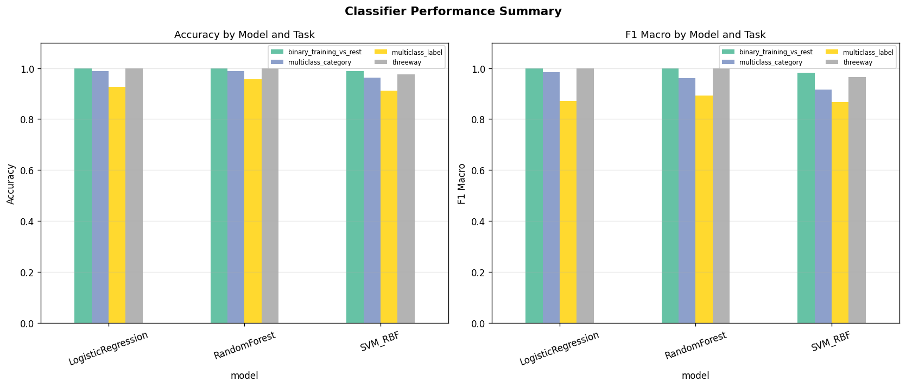
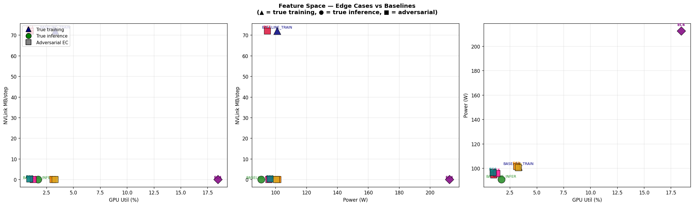

# Classifying GPU Workloads via Always-Available Telemetry for AI Compute Governance

**Sabiha Tajdari**, University of Virginia, jvx2tt@virginia.edu

**Robi Rahman**, Machine Intelligence Research Institute, robi@intelligence.org

---

## Abstract

Hardware-enabled governance of AI compute requires the ability to distinguish ML training from other GPU workloads. We show that always-available Tier 1 NVML telemetry---GPU utilization, power draw, memory usage, and NVLink traffic, collected at zero runtime overhead---is sufficient for this task. Using 73 statistical features extracted from 80 workload runs on NVIDIA A100 and H100 GPUs, a Random Forest classifier achieves 100% binary accuracy (training vs. non-training) and 95.6% accuracy across 15 workload types. We design six adversarial edge cases that attack specific feature subsets; the hardest (frozen-backbone training) lies only L2 = 0.86 from inference in feature space. No single telemetry signal distinguishes all cases; a joint feature vector spanning utilization, power, timing, and NVLink counters is necessary and sufficient.

**Keywords:** GPU telemetry, workload classification, AI governance, adversarial robustness

## Introduction

AI compute governance proposals increasingly rely on the ability to verify what workloads run on regulated hardware [1]. Existing profiling tools such as NVIDIA Nsight Compute can fingerprint GPU workloads but impose 1,200--5,300% runtime overhead [2], making continuous deployment impractical. We ask: *can zero-overhead, always-available GPU telemetry reliably distinguish ML training from other workloads---even when an operator adversarially disguises the workload?*

We make four contributions: (1) a telemetry-based classifier achieving 100% binary and 95.6% 15-class accuracy using only Tier 1 NVML metrics at zero overhead; (2) systematic adversarial robustness testing with six evasion strategies; (3) a demonstration that joint feature vectors are necessary---no single signal suffices; and (4) a concrete recommendation of which metrics a Hardware-Enabled Mechanism (HEM) should monitor.

## Related Work

WAVE [2] fingerprints LLM *inference* workloads using nine Nsight Compute performance counters, achieving 87--93% model identification accuracy. However, it targets inference rather than training and requires expensive Tier 3 profiling. Differential Architecture [3] characterizes hardware bottleneck regimes (compute-bound, memory-bound, cache-bound) across GPU workload classes but does not build classifiers or test adversarial evasion. ShadowScope [4] validates GPU kernel behavior via CUPTI performance counters for governance applications. No prior work addresses training-specific detection combined with adversarial robustness using zero-overhead telemetry.

## Methods

**Hardware and telemetry.** Experiments run on 2x NVIDIA H100 80 GB HBM3 GPUs with NVLink 4.0, validated on A100 SXM4. We poll `pynvml` at 100--200 ms intervals, capturing nine raw signals: GPU utilization, memory utilization, memory used, power draw, temperature, SM clock, memory clock, and PCIe TX/RX bandwidth. This Tier 1 telemetry imposes zero runtime overhead.

**Feature extraction.** From each run's time series we compute 73 aggregate features: mean, standard deviation, coefficient of variation (CV), skewness, kurtosis, autocorrelation at lag 1, and the 5th/95th percentiles for each signal.

**Workloads.** We collect 80 runs across 15 workload types spanning five categories: ML training (ResNet, BERT, GPT-2, MLP in FP32 and AMP, single-GPU and DDP), ML inference (ResNet-50), scientific HPC (3D FFT, N-body), crypto mining (Ethash proxy), rendering (Monte Carlo ray tracing), and idle baseline.

**Classifiers.** We train Random Forest, Logistic Regression, and SVM-RBF classifiers on four tasks: binary (training vs. rest), three-way (training/inference/other), 7-category, and 15-class. Evaluation uses stratified group k-fold cross-validation grouped by run ID to prevent data leakage.

**Adversarial edge cases.** We design six workloads that attack specific classifier features: (1) phantom training (inference + fake allreduce), (2) silent training (`no_sync` suppresses NVLink), (3) sparse sync (gradient accumulation x16), (4) mining-like inference (high-batch, max utilization), (5) frozen-backbone training (head-only fine-tuning), and (6) low-intensity training (tiny model, small batch).

## Results

### Clean-Data Classification

On 80 runs (21,617 telemetry rows, 73 features), the Random Forest achieves 100% binary accuracy (training vs. rest), 100% three-way accuracy, 98.75% on 7 categories, and 95.6% on all 15 workload labels. Logistic Regression matches the binary and three-way results. Sliding-window evaluation at 30 s windows also achieves 100% binary accuracy. The top discriminating features are GPU utilization CV (19% importance), SM clock standard deviation (15%), and memory features (24% combined); see Figure 1. A simple decision rule---GPU utilization CV > 30%---correctly identifies all training runs in our dataset.

### Adversarial Robustness

Six adversarial workloads probe classifier boundaries (Figure 2). The hardest case is EC-5 (frozen backbone): with only 5,120 bytes of gradient payload, its NVLink and memory signatures are indistinguishable from inference (L2 = 0.86). The easiest to detect is EC-4 (mining-like inference, L2 > 7.0) due to its anomalous power draw (213 W vs. 91 W baseline). Critically, no single feature separates all cases. EC-1 defeats NVLink-only classifiers; EC-2 defeats them from the opposite direction; EC-6 falls within the inference range on *every* individual feature. Only the joint vector---forward time, backward time, allreduce time, NVLink bytes, utilization, and power---correctly classifies all eight workloads (six adversarial plus two baselines).

## Discussion

The GPU microarchitecture acts as an *involuntary witness*: the physical constraints of computation impose characteristic signatures that cannot be simultaneously falsified across all observable dimensions. An adversary can suppress NVLink traffic (EC-2) or mimic inference timing (EC-5), but doing both while maintaining training functionality requires accepting significant throughput or accuracy penalties.

The frozen-backbone case (EC-5) is particularly instructive: it shows that a governance system must monitor backward-pass timing, not just utilization or NVLink volume. This has a concrete design implication for HEMs: logging forward and backward pass durations at the framework level, alongside Tier 1 NVML counters, would close the remaining detection gap.

**Limitations.** All experiments use a single two-GPU node; multi-node distributed training may distribute the allreduce signature differently. Tier 1 NVML cannot observe kernel-level instruction mix, unlike WAVE's Tier 3 profiling. The adversarial strategies are researcher-designed; a real-world adversary with full classifier knowledge may find additional evasion vectors.

**Future work.** We plan cross-GPU generalization experiments on a third architecture (RTX 5070 Ti), physical side-channel validation via wall-power measurement, and an expanded adversarial evaluation.

## Conclusion

Always-available Tier 1 NVML telemetry can detect ML training with 100% binary accuracy under clean conditions and identify the hardest adversarial evasion (frozen backbone, L2 = 0.86). No single feature suffices; joint feature vectors are necessary. These results provide an empirical foundation for hardware-enabled monitoring: a HEM logging GPU utilization, power, memory, and NVLink traffic at 100 ms intervals would be sufficient for training detection at zero runtime overhead.

## References

[1] O. Aarne, T. Fist, and C. Withers. "Secure, Governable Chips: Using On-Chip Mechanisms to Manage National Security Risks from AI & Advanced Computing," 2024.

[2] Z. Xu et al. "WAVE: Leveraging Architecture Observation for Privacy-Preserving Model Oversight," ASPLOS 2026.

[3] Anonymous. "Differential Architecture: Limiting Performance of Targeted Applications," under review at ISCA, 2026.

[4] A. Jackowski, M. Copik, and T. Hoefler. "ShadowScope: From GPU Kernel Validation to Governing AI Chip Usage," arXiv:2509.00300, 2025.
